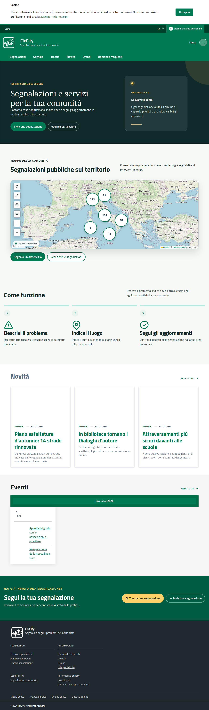

> Screenshot reale del front office FixCity, verificato il 23 novembre 2026. Per questo modulo è una superficie condivisa: il manuale non attribuisce al modulo una UI propria se non documentata dalle fonti.

# Scopo

Fixcity gestisce le segnalazioni cittadine: consultazione pubblica, invio e
tracciamento nel front office, presa in carico e lavorazione nel backoffice
del Comune. Questo manuale descrive solo capacità risultanti dalle policy e
dal workflow del modulo.

## Attori e capacità effettive

| Attore | Dominio | Capacità verificata |
| --- | --- | --- |
| Ospite | Cittadino/front office | Vede una segnalazione solo se pubblica; non crea segnalazioni. |
| Autenticato | Cittadino/front office | Crea una segnalazione; vede le pubbliche e le proprie; aggiorna la propria. |
| Utente in gruppo/team | Cittadino o organizzazione | N/A nel workflow Fixcity verificato: l'appartenenza a un gruppo non sostituisce proprietà, policy o ruolo PA. |
| `operator` | Comune/backoffice | Con `fixcity::admin` entra nel pannello; opera sulle segnalazioni: visualizza, aggiorna, assegna, cambia stato, comunica e cambia priorità. |
| `supervisor` | Comune/backoffice | Come `operator` per le capacità dichiarate da `TicketPolicy`; il ruolo non abilita da solo la cancellazione. |
| `admin` | Comune/backoffice | Capacità PA sopra indicate e cancellazione (`ticket.delete`) secondo policy. Deve avere l'accesso al pannello pertinente. |
| `super-admin` | Backoffice | Bypass della policy Fixcity; non sostituisce necessariamente l'accesso al pannello Filament. |
| Moderatore | — | N/A: non esiste un ruolo `moderator` nelle fonti del modulo. |

`fixcity::admin` è il ruolo di accesso al pannello, non un bypass delle
policy delle segnalazioni. Un permesso esplicito `ticket.*` può concedere le
singole capacità previste dalla policy; non si presume che un ruolo generico
le possieda.

## Flussi

### Cittadino

1. L'ospite consulta mappa/elenco e apre solo segnalazioni pubbliche.
2. L'utente autenticato crea una segnalazione e può rivedere la propria.
3. Il cittadino segue l'avanzamento mentre la pratica attraversa gli stati
   consentiti; la segnalazione non pubblica resta fuori dalla vista pubblica.

### Comune

L'operatore apre il pannello con `fixcity::admin`, esamina la segnalazione,
la assegna, aggiorna stato/priorità e comunica. Le transizioni non sono
libere: `open → pending`, poi i passaggi ammessi da `in_review`,
`in_progress`, `on_hold`, `resolved` e `reopened`; `closed` è terminale.
La cancellazione è amministrativa e non deriva dalla proprietà della pratica.

## Prerequisiti e limiti

- L'ospite non può creare; per creare serve un'identità autenticata oppure il
  permesso esplicito `ticket.create`.
- Per il backoffice servono autenticazione e accesso al pannello; i ruoli PA
  sono `operator`, `supervisor`, `admin`.
- `draft` e `pending` sono stati interni; gli altri stati elencati come
  pubblici da `TicketStatusEnum` sono visibili a tutti se la segnalazione lo
  consente.
- N/A: il modulo non documenta qui gestione utenti, consenso GDPR o
  configurazione linguistica; sono responsabilità di altri moduli.

## Riferimenti verificabili

- `app/Policies/BasePolicy.php:31-65` — ruoli PA e bypass `super-admin`.
- `app/Policies/TicketPolicy.php:13-72` — capacità effettive per ospite,
  proprietario, PA e permessi `ticket.*`.
- `app/Enums/TicketStatusEnum.php:37-69,93-145` — visibilità e transizioni.
- `docs/manuale/cittadini.md:34-37,120-135` — uso del front office.
- `docs/manuale/operatori.md:13-21,85-123` — prerequisiti e flusso operativo.
- `docs/manuale/amministratori.md:12-38` — ruoli del backoffice.

