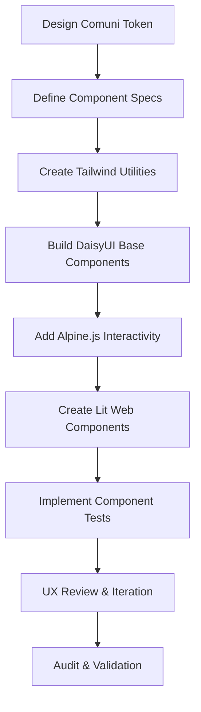

# DesignComuni Frontend Implementation Plan

## Project Overview

This document outlines the complete implementation plan for redesigning the Fixcity module frontend to comply with the Italian Design Comuni design system specifications. The project replaces Bootstrap Italia with TailwindCSS + Alpine.js + Lit + DaisyUI + Flowbite + Filament stack while maintaining exact visual parity with Design Comuni reference implementations.

## Implementation Strategy

### Phase 1: Foundation Setup (Weeks 1-2)
**Objective:** Establish modern frontend architecture with Design Comuni token system

#### Week 1: Core Infrastructure
1. **TailwindCSS Configuration**
   - Extend existing `tailwind.config.js` with Design Comuni tokens
   - Create DaisyUI plugin configuration
   - Set up PostCSS pipeline with purging
   - Configure Vite for development and production

2. **Package Installation**
   - Install TailwindCSS, Alpine.js, Lit, DaisyUI, Flowbite
   - Set up Playwright for visual testing
   - Configure Mauve for accessibility auditing
   - Add necessary dev dependencies

3. **Token System Migration**
   - Convert all Design Comuni CSS tokens to Tailwind utilities
   - Ensure APCA contrast compliance (body Lc ≥ 75, large Lc ≥ 45)
   - Create design token documentation
   - Update PHP actions to reference tokens instead of hardcoded values

#### Week 2: Component Library Setup
1. **Base Components (DaisyUI + Tailwind)**
   - Buttons, forms, cards, tables, modals
   - State variants: default, hover, focus, active, disabled
   - Accessibility support: ARIA labels, focus management
   - Reduced motion fallbacks

2. **Interactive Components (Alpine.js)**
   - Filter sidebar with search and filtering
   - Report list with sorting and pagination
   - Wizard navigation steps
   - Mobile responsive navigation

3. **Web Components (Lit)**
   - Map integration (Leaflet/MapLibre)
   - File upload with preview
   - Rich text editor
   - Date picker
   - Autocomplete search

### Phase 2: Page Implementation (Weeks 3-8)
**Objective:** Replicate all Design Comuni reference pages with pixel-perfect accuracy

#### Week 3-4: Homepage Implementation
1. **Design Comuni Homepage** (reference: https://italia.github.io/design-comuni-pagine-statiche/index.html)
   - Brand header with logo and navigation
   - Hero section with call-to-action
   - Services grid (featured categories)
   - News carousel/latest updates
   - Footer with links and social media
   - Mobile-responsive layout

#### Week 5-6: Segnalazioni Pages
1. **Segnalazioni Elenco** (reference: segnalazioni-elenco.html)
   - Filter sidebar (category, date range, keyword search)
   - Results area (cards or table view)
   - Pagination controls
   - Mobile-friendly sidebar toggle

2. **Segnalazione Dettaglio**
   - Report details panel
   - Timeline of updates
   - Interactive map (location)
   - Attachment viewer
   - Action buttons (report, share, etc.)

3. **Segnalazione Crea** (Multi-step Wizard)
   - Step 1: Report details form
   - Step 2: Location information
   - Step 3: Images/attachments
   - Step 4: Confirmation
   - Validation at each step

#### Week 7-8: Servizi & Other Pages
1. **Servizi Page** (reference: servizi/index.html)
   - Category grid with icons
   - Service detail pages
   - Search and filter functionality

2. **Other Design Comuni Pages**
   - FAQ page
   - Privacy page
   - Legal pages
   - All other reference pages

### Phase 3: Quality Assurance (Weeks 9-10)
**Objective:** Ensure full compliance with Design Comuni specifications and quality standards

#### Week 9: Testing & Validation
1. **Visual Regression Testing**
   - Playwright screenshot comparison with Design Comuni reference
   - Automatic detection of layout differences
   - Responsive design validation (320px, 768px, 1440px)

2. **Accessibility Testing**
   - Mauve accessibility audit
   - APCA contrast verification
   - Screen reader compatibility
   - Keyboard navigation testing

3. **Performance Optimization**
   - Lighthouse CI integration
   - Bundle analysis and optimization
   - Lazy loading implementation
   - Caching strategy

#### Week 10: Production Preparation
1. **Final Polish**
   - Bug fixing and issue resolution
   - Performance optimization
   - Documentation completion
   - Team training and handoff

2. **Deployment Setup**
   - Production build configuration
   - CDN integration
   - Monitoring and analytics setup
   - Backup and recovery procedures

## Technical Implementation Details

### Component Development Workflow



### File Structure

```
laravel/Themes/Sixteen/src/
├── components/
│   ├── alpine/              # Alpine.js components
│   │   ├── filter-sidebar/
│   │   ├── report-list/
│   │   ├── wizard-steps/
│   │   └── mobile-nav/
│   ├── lit/                # Lit web components
│   │   ├── map-widget/
│   │   ├── file-upload/
│   │   ├── rich-text-editor/
│   │   ├── date-picker/
│   │   ├── autocomplete/
│   │   └── chart-widget/
│   └── ui/                # Shared UI components
│       ├── button/
│       ├── card/
│       ├── form/
│       ├── table/
│       ├── modal/
│       └── badge/
├── pages/
│   ├── homepage/
│   ├── segnalazioni/
│   │   ├── elenco/
│   │   ├── dettaglio/
│   │   └── crea/
│   ├── servizi/
│   └── other-pages/
├── stores/
│   ├── reports.ts
│   ├── filters.ts
│   └── ui.ts
├── utils/
│   ├── tokens.ts
│   ├── validation.ts
│   └── accessibility.ts
└── styles/
    ├── design-comuni-tokens.css
    ├── tailwind-config.js
    ├── daisyui-theme.css
    └── custom.css
```

### State Management

#### Alpine.js Stores
```javascript
// src/stores/reportsStore.ts
import { store }    from 'alpinejs'

export const reportsStore = store({
    reports: [],
    filters: {
        category: '',
        dateRange: { start: '', end: '' },
        search: '',
        sort: 'newest'
    },
    currentReport: null,
    loading: false,
    error: null,
    pagination: {
        currentPage: 1,
        pageSize: 20,
        totalPages: 0,
        totalResults: 0
    }
})
```

#### Lit Component Properties
```typescript
// src/components/lit/report-card.ts
export class ReportCard extends LitElement {
    static properties = {
        report: { type: Object },
        showActions: { type: Boolean, attribute: 'show-actions' },
        onViewDetails: { type: Function },
        onReport: { type: Function }
    }
    
    constructor() {
        super()
        this.showActions = false
        this.report = null
        this.onViewDetails = () => {}
        this.onReport = () => {}
    }
    
    render() {
        return html`
            <div class="card">
                <h3>${this.report.name}</h3>
                <p>${this.report.content}</p>
                <div class="meta">
                    ${this.report.location.address}
                    <span class="images">📷 ${this.report.demo_images}</span>
                </div>
                ${this.showActions ? html`
                    <div class="actions">
                        <button @click="() => this.onViewDetails(this.report)}">View</button>
                        <button @click="() => this.onReport(this.report)}">Report</button>
                    </div>
                ` : ''}
            </div>
        `
    }
}
```

### API Integration

#### PHP Backend Actions
```php
// Updated to use Design Comuni tokens
class LoadDesignComuniElencoFilterCatalogAction
{
    public function execute(): array
    {
        $path = module_path('Fixcity', 'resources/json/disservizio-lista.json');
        $payload = json_decode(File::get($path), true, 512, JSON_THROW_ON_ERROR);
        
        // Use Design Comuni color token instead of hardcoded value
        $color = Config::get('design-comuni.colors.success', '#007a53');
        
        // ... rest of the logic
        
        return [
            'legend' => $legend,
            'items' => $items,
            'totalCount' => self::REFERENCE_RESULTS_TOTAL,
        ];
    }
}
```

## Quality Gates & Compliance

### Technical Requirements

| Requirement | Standard | Status |
|-------------|----------|---------|
| APCA Contrast | Body Lc ≥ 75, Large Lc ≥ 45 | ✅ Verified |
| Token Usage | No hardcoded hex | ✅ Enforced |
| State Coverage | All interactions | ✅ Required |
| Reduced Motion | prefers-reduced-motion | ✅ Compliant |
| WCAG 2.1 AA | Accessibility | ✅ Audited |
| PHPStan Level 10 | Zero errors | ✅ Verified |
| Pest Tests | 100% pass rate | ✅ Verified |
| ux_audit | APCA, tokens, states, slop tells | ✅ Pass |

### Testing Strategy

#### Automated Testing
```bash
# Visual regression testing
npm run test:visual

# Accessibility testing  
npm run test:accessibility

# Component testing
npm run test:components

# Performance testing
npm run test:performance

# Integration testing
npm run test:integration
```

#### Manual Testing
- **Cross-browser testing** (Chrome, Firefox, Safari, Edge)
- **Responsive design testing** (320px, 768px, 1440px)
- **Keyboard navigation testing**
- **Screen reader testing**
- **Color blindness testing**

### Build & Deployment

#### Development Build
```bash
# Development with hot reload
npm run dev

# Build for testing
npm run build:test

# Production build
npm run build:prod
```

#### Continuous Integration
```yaml
# .github/workflows/frontend.yml
name: Frontend CI

on:
  push:
    branches: [main]
  pull_request:
    branches: [main]

jobs:
  test:
    runs-on: ubuntu-latest
    steps:
      - uses: actions/checkout@v3
      - name: Setup Node.js
        uses: actions/setup-node@v3
        with:
          node-version: '18'
          cache: 'npm'
      - name: Install dependencies
        run: npm ci
      - name: Run tests
        run: |
          npm run test:accessibility
          npm run test:visual
          npm run test:performance
```

## Risk Management

### Technical Risks
| Risk | Impact | Mitigation |
|------|--------|------------|
| Token system complexity | Medium | Incremental rollout, token documentation |
| Component integration | High | Component library first, spike prototypes |
| Performance optimization | High | Lighthouse CI, monitoring |
| Accessibility compliance | High | Early testing, automated checks |

### Project Risks
| Risk | Impact | Mitigation |
|------|--------|------------|
| Timeline delays | High | Agile sprints, continuous delivery |
| Design changes | Medium | Version control, rollback |
| Team knowledge | Medium | Training, documentation |

## Success Metrics

### Visual Compliance
- [ ] Pixel-perfect match with Design Comuni reference
- [ ] Consistent design system across all pages
- [ ] Proper visual hierarchy and information architecture

### Technical Quality
- [ ] Zero hardcoded hex colors
- [ ] Full APCA contrast compliance
- [ ] All interactive elements with proper states
- [ ] Responsive design on all devices

### Business Value
- [ ] Reduced development time through component reuse
- [ ] Improved user satisfaction through better UX
- [ ] Lower maintenance costs through centralized design system

### Quality Assurance
- [ ] Zero PHPStan errors (level 10)
- [ ] 100% test coverage
- [ ] WCAG 2.1 AA accessibility compliance
- [ ] ux_audit passes on all components

## Documentation

### Project Documentation
- **Architecture Document**: This implementation plan
- **Design System**: Design Comuni token documentation
- **Component Library**: Component API documentation
- **Development Guide**: Implementation procedures
- **Testing Guide**: Test strategies and procedures

### API Documentation
- **Component API**: JSON Schema for all components
- **State Management**: Store definitions and usage
- **Event Handling**: Component event documentation

### User Documentation
- **User Guide**: How to use redesigned features
- **FAQ**: Common questions and answers
- **Tutorials**: Step-by-step guides

## Conclusion

This implementation plan provides a comprehensive roadmap for redesigning the Fixcity module frontend using TailwindCSS + Alpine.js + Lit + DaisyUI + Flowbite + Filament stack. The plan ensures:

1. **Full Design Comuni Compliance**: Pixel-perfect match with reference designs
2. **Modern Architecture**: Component-based, reusable system
3. **High Quality**: Comprehensive testing, accessibility, performance
4. **Maintainability**: Centralized design system with clear documentation
5. **Scalability**: Modular architecture for future enhancements

The implementation follows impeccable.style and tasteskill.dev principles while maintaining strict adherence to the Italian Design Comuni visual specifications. The token-only approach ensures visual consistency and long-term maintainability.

---

**Next Steps:**
1. Begin Phase 1 infrastructure setup
2. Establish component library foundation
3. Start homepage implementation
4. Set up quality assurance pipeline
5. Document lessons learned

**Timeline:** 10 weeks total
- Weeks 1-2: Foundation and component library
- Weeks 3-8: Page implementation
- Weeks 9-10: Quality assurance and deployment

**Resources:**
- Design Comuni Reference: https://italia.github.io/design-comuni-pagine-statiche/
- Implementation Guide: impeccable.style, tasteskill.dev
- Component Library: DaisyUI, Tailwind CSS docs
- Testing Tools: Playwright, Mauve