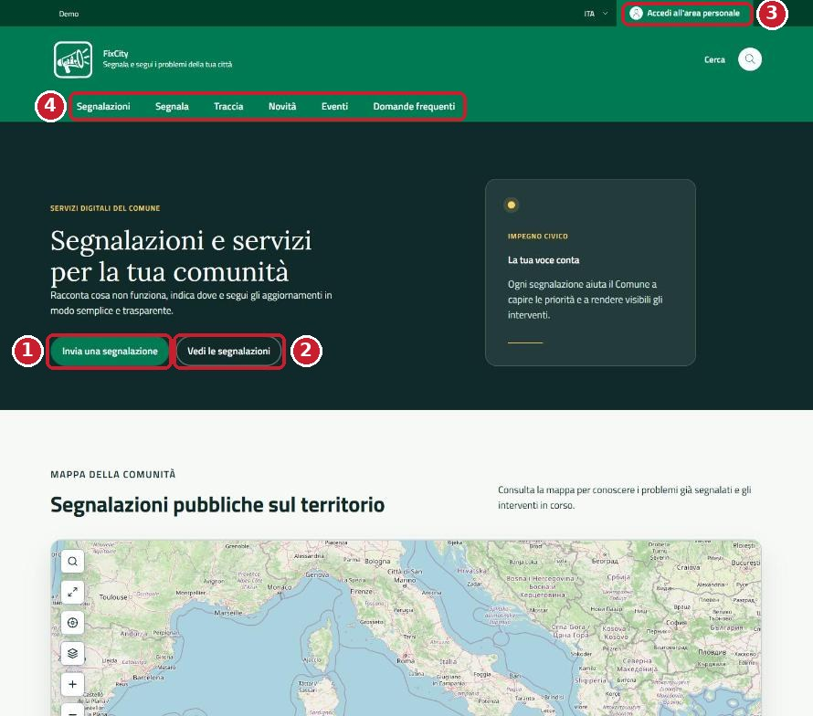
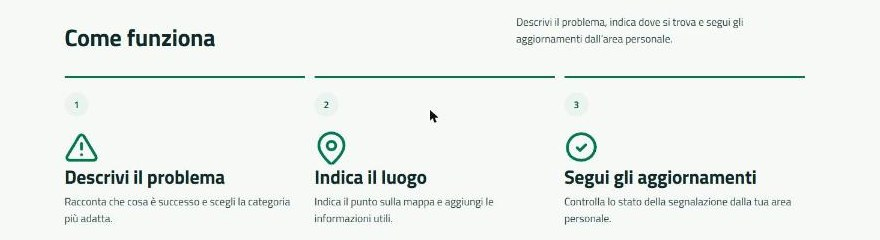
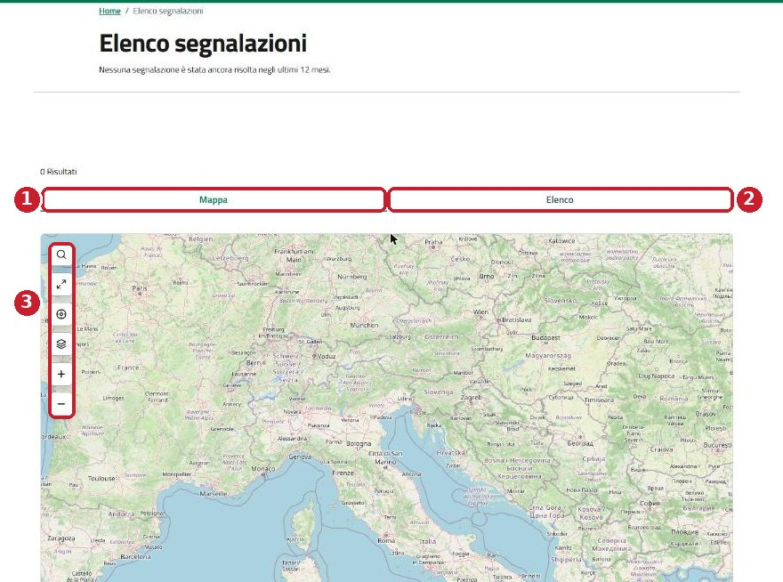
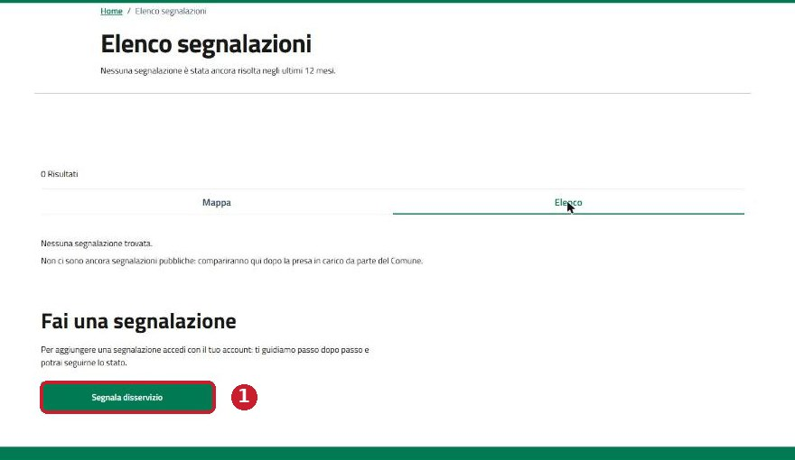
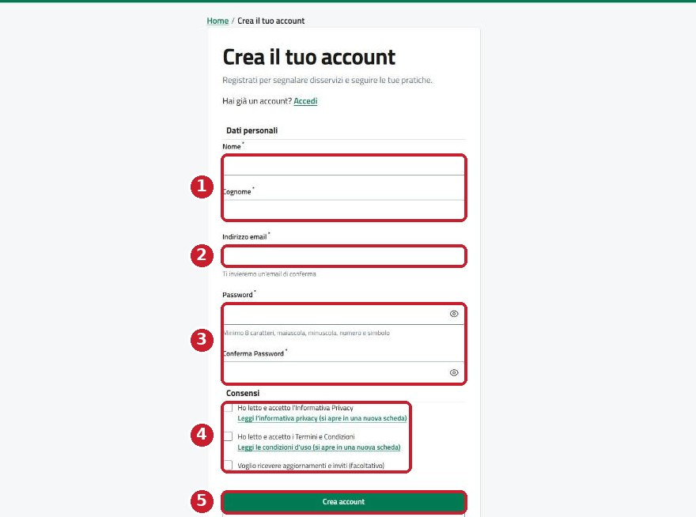
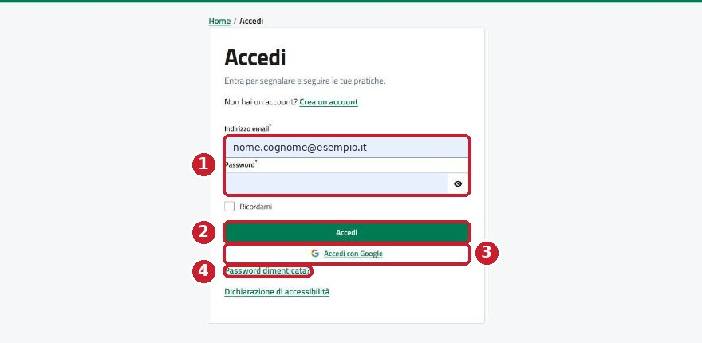
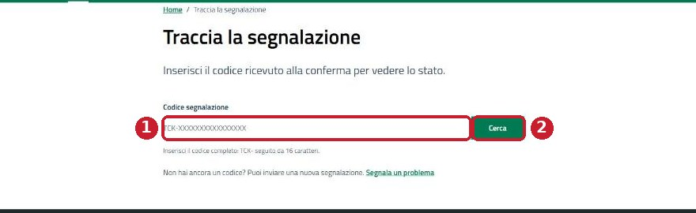

# Guida per i cittadini

Questa guida spiega, un clic alla volta, come segnalare un problema al Comune e sapere quando viene risolto. Non serve
nessuna esperienza: basta un telefono o un computer con internet.

## Prima di iniziare

Ti servono tre cose:

- **Un dispositivo con internet**: telefono, tablet o computer. Va bene qualsiasi browser recente (Chrome, Safari, Firefox,
  Edge).
- **Un indirizzo email** che controlli: ci arrivano la conferma dell'account e gli aggiornamenti.
- **Qualche minuto**: inviare una segnalazione richiede circa 3 minuti.

Alcune parole che troverai:

| Parola | Cosa vuol dire |
| --- | --- |
| Segnalazione | Il messaggio con cui avvisi il Comune di un problema, ad esempio una buca o un lampione spento |
| Codice segnalazione | Un codice come `TCK-` seguito da 16 caratteri. Lo ricevi alla fine e serve a seguire la tua segnalazione |
| Area personale | La tua pagina privata, dove trovi le segnalazioni che hai inviato |
| Stato | A che punto è la segnalazione: In attesa, In lavorazione, Risolto e così via |

Nelle immagini di questa guida i **cerchi rossi numerati** indicano dove cliccare. Il numero corrisponde al passo spiegato
sotto l'immagine.

## Guardare le segnalazioni senza account

Puoi vedere tutte le segnalazioni già approvate dal Comune senza registrarti. È utile per controllare se qualcuno ha già
segnalato il tuo problema.

**La pagina iniziale**

Apri il browser e scrivi l'indirizzo del sito del tuo Comune, ad esempio `fixcity.eu`.

*Figura 1 - La pagina iniziale di FixCity.*

1. **Invia una segnalazione**: il pulsante verde per segnalare un nuovo problema.
2. **Vedi le segnalazioni**: apre l'elenco di tutte le segnalazioni pubbliche.
3. **Accedi all'area personale**: in alto a destra, per entrare con il tuo account.
4. **Menu principale**: Segnalazioni, Segnala, Traccia, Novità, Eventi, Domande frequenti. Da telefono il menu è dietro
   l'icona con tre righe.

Scorrendo la pagina trovi la mappa e il riquadro **Come funziona**, che riassume i tre passi.

*Figura 2 - Il riquadro "Come funziona".*

**L'elenco delle segnalazioni**

Premi **Vedi le segnalazioni** oppure la voce **Segnalazioni** nel menu.

*Figura 3 - La pagina "Elenco segnalazioni", vista Mappa.*

1. **Mappa**: ogni segnaposto è una segnalazione. Premi un segnaposto per vederne il riassunto.
2. **Elenco**: mostra le stesse segnalazioni come lista, più comoda da telefono o se non usi il mouse.
3. **Comandi della mappa**: cerca un indirizzo, schermo intero, la tua posizione, tipo di mappa, ingrandisci e
   rimpicciolisci.

*Figura 4 - La vista Elenco quando non ci sono ancora segnalazioni pubbliche.*

Se l'elenco è vuoto vuol dire che il Comune non ha ancora approvato nessuna segnalazione. Il pulsante
**Segnala disservizio** (1) ti porta a inviarne una.

## Creare l'account

L'account si crea una volta sola. Dopo entri sempre con la stessa email e password.

Premi **Accedi all'area personale** in alto a destra e poi **Crea un account**, oppure apri direttamente l'indirizzo
`/it/auth/register`.

*Figura 5 - La pagina "Crea il tuo account".*

1. Scrivi **Nome** e **Cognome**.
2. Scrivi il tuo **Indirizzo email**. Controlla che sia giusto: ci arriva il collegamento per confermarlo.
3. Scegli una **Password** e riscrivila in **Conferma Password**. Deve avere almeno 8 caratteri, con una lettera maiuscola,
   una minuscola, un numero e un simbolo, ad esempio `Lampione!2026`. L'icona a forma di occhio mostra quello che hai
   scritto.
4. Spunta le due caselle obbligatorie: **Informativa Privacy** e **Termini e Condizioni**. I collegamenti sotto ciascuna
   aprono il testo completo. La terza casella, per ricevere aggiornamenti e inviti, è facoltativa.
5. Premi **Crea account**. Entri nella tua area personale e vedi il messaggio "Il tuo account è pronto".

*Figura 6 - In fondo al modulo: accesso con Google e password dimenticata.*

1. **Accedi con Google**: se hai un account Google puoi usarlo al posto di email e password, se il tuo Comune ha attivato
   questa possibilità.
2. **Password dimenticata?**: serve quando hai già un account ma non ricordi la password.

### Confermare l'email

Subito dopo la registrazione ricevi un'email da FixCity. **Senza questa conferma puoi guardare le segnalazioni ma non
inviarne di nuove.**

1. Apri la tua casella di posta e cerca l'email di FixCity. Se non c'è, guarda nella cartella spam.
2. Premi il collegamento nell'email. Se non hai fatto l'accesso, il sito ti chiede prima email e password.
3. L'indirizzo risulta confermato e torni al modulo di segnalazione.

Se provi a inviare una segnalazione prima di confermare, il sito ti porta alla pagina **Verifica il tuo indirizzo email**.
Lì trovi il collegamento **clicca qui per richiederne un altro**, che ti manda una nuova email. Il collegamento vale per un
tempo limitato: se è scaduto, chiedine un altro.

## Accedere

Se hai già un account, premi **Accedi all'area personale** in alto a destra (indirizzo `/it/auth/login`).

*Figura 7 - La pagina "Accedi".*

1. Scrivi **Indirizzo email** e **Password**. Spunta **Ricordami** solo sul tuo dispositivo personale, mai su un computer
   condiviso.
2. Premi **Accedi**.
3. **Accedi con Google**: in alternativa, se il Comune l'ha attivato.
4. **Password dimenticata?**: inserisci la tua email e segui il collegamento che ricevi per sceglierne una nuova. Se l'email
   non arriva entro qualche minuto, guarda nella cartella spam.

L'accesso con SPID o CIE non è ancora disponibile.

## Inviare una segnalazione

Il modulo ha tre passi e una pagina finale. In alto vedi sempre a che passo sei. Le schermate di questa sezione verranno
aggiunte appena disponibile un accesso di prova.

Prima di cominciare:

- se puoi, scatta una foto del problema da qualche metro, in modo che si capisca dove si trova;
- evita di inquadrare volti o targhe leggibili, perché dopo l'approvazione la foto diventa pubblica (i PDF invece restano
  visibili solo a te e al Comune);
- se sei sul posto, attiva la posizione del telefono quando il browser te lo chiede.

**Passo 0. Apri il modulo**

Premi **Invia una segnalazione** nella pagina iniziale. Se non hai fatto l'accesso, il sito ti porta alla pagina
**Accedi**; se non hai ancora confermato l'email, alla pagina **Verifica il tuo indirizzo email**. Dopo torni al modulo.

**Passo 1. Privacy**

1. Leggi l'informativa: spiega chi tratta i tuoi dati e perché.
2. Spunta la casella di accettazione. Senza questa spunta non si può andare avanti.
3. Premi **Avanti**.

**Passo 2. Dati della segnalazione**

1. **Luogo**: scrivi l'indirizzo, ad esempio "Via Roma 12", e scegli quello giusto dall'elenco che compare. In alternativa
   sposta il segnaposto sulla mappa fino al punto esatto.
2. **Tipo di disservizio**: apri l'elenco e scegli la voce più vicina al tuo problema. Se nessuna va bene, scegli **Altro**.
3. **Titolo**: una frase breve, da 3 a 255 caratteri. Esempio: "Buca davanti al civico 12".
4. **Dettagli**: da 10 a 200 caratteri. Scrivi cosa vedi e perché è un problema. Esempio: "Buca profonda circa 20 cm,
   pericolosa per bici e scooter".
5. **Immagini**: facoltative, fino a 5 file JPEG, PNG o PDF, ciascuno al massimo di 10 MB. Da telefono puoi scattare la foto
   direttamente.
6. **Autore**: nome ed email vengono presi dal tuo account, non devi riscriverli.
7. Premi **Avanti**. Se manca qualcosa, il campo viene evidenziato in rosso con la spiegazione.

**Passo 3. Riepilogo**

1. Controlla tutto, compresa la posizione sulla mappa.
2. Per correggere, premi **Indietro**: i dati già inseriti restano.
3. Premi **Invia** una sola volta. Durante l'invio il pulsante si disattiva.

**Pagina finale. Segnalazione inviata**

Vedi il messaggio **Segnalazione inviata** con il **codice** della segnalazione. Copialo o fotografalo: serve per seguirla.
Ricevi anche **una email di conferma** con lo stesso codice, nella lingua che stai usando sul sito.

La segnalazione ora è **In attesa**, cioè il Comune deve ancora approvarla. Finché non viene approvata la vedi solo tu,
nella tua area personale.

## Seguire una segnalazione con il codice

Con il codice puoi vedere lo stato di una segnalazione anche senza entrare nel tuo account.

In fondo alla pagina iniziale trovi il riquadro **Segui la tua segnalazione**.

*Figura 8 - Il riquadro "Segui la tua segnalazione" nella pagina iniziale.*

1. Premi **Traccia una segnalazione**, oppure la voce **Traccia** nel menu.

*Figura 9 - La pagina "Traccia la segnalazione".*

1. Scrivi il codice completo nel campo **Codice segnalazione**: `TCK-` seguito da 16 caratteri. Il modo più sicuro è
   copiarlo e incollarlo.
2. Premi **Cerca**: compare la scheda della segnalazione con lo stato, gli aggiornamenti e le foto.

Se sbagli il codice più di 10 volte in un minuto, la ricerca si blocca per qualche istante. Aspetta un minuto e riprova.

## Area personale e notifiche

Dopo l'accesso, premi il tuo nome in alto a destra per aprire l'area personale. Le schermate verranno aggiunte appena
disponibile un accesso di prova.

| Sezione | Cosa trovi | Quando usarla |
| --- | --- | --- |
| Le mie segnalazioni | Quelle che hai inviato, con codice e stato | Per sapere a che punto sono le tue segnalazioni |
| Segnalazioni che seguo | Quelle di altri cittadini che stai seguendo | Quando lo stesso problema interessa anche te |
| Notifiche | Gli aggiornamenti ricevuti | Per vedere cosa è cambiato dall'ultima volta |
| Impostazioni e privacy | Preferenze per le email, dati dell'account, diritti sui dati, eliminazione dell'account | Per smettere di ricevere email o chiudere l'account |

**Seguire la segnalazione di un altro cittadino**

1. Apri la segnalazione dall'elenco o dalla mappa.
2. Premi **Segui questa segnalazione**.
3. La trovi in **Area personale > Segnalazioni che seguo** e ricevi i suoi aggiornamenti.

**Quando arrivano le notifiche**

Ricevi una notifica quando la segnalazione viene creata e ogni volta che cambia stato. Se in **Impostazioni e privacy** hai
attivato le email, ricevi anche un'email. Il significato di ogni stato è spiegato nella [Panoramica](panoramica.md).

**Cancellare l'account**

In **Impostazioni e privacy**, nella parte dedicata all'eliminazione, scrivi un motivo se vuoi, spunta la conferma e premi
**Elimina il mio account**. L'account viene disattivato subito: da quel momento non si può più entrare, né dal sito né
dall'app. I dati dell'account restano finché il Comune chiude le tue segnalazioni aperte, poi vengono cancellati; le
segnalazioni restano nell'archivio del Comune.

## Se qualcosa va storto

| Cosa succede | Perché | Cosa fare |
| --- | --- | --- |
| Non vedo la mia segnalazione sulla mappa | Le nuove segnalazioni restano nascoste finché il Comune non le approva | Controlla in **Area personale > Le mie segnalazioni**: lì la vedi sempre |
| Il sito mi manda a "Verifica il tuo indirizzo email" | Non hai ancora confermato l'email | Apri il collegamento nell'email di FixCity, oppure chiedine un altro dalla pagina |
| Il modulo non va avanti | Un campo obbligatorio è vuoto o troppo corto | Cerca il campo evidenziato in rosso e leggi il messaggio sotto |
| L'invio è bloccato: "Il Comune non ha ancora completato i propri dati nell'informativa privacy" | Il Comune non ha finito di configurare il servizio | Riprova più tardi, oppure avvisa l'ufficio indicato in **Contatti** |
| La descrizione non entra | I dettagli sono al massimo 200 caratteri | Scrivi l'essenziale e aggiungi il resto con un commento dopo l'invio |
| La foto non si carica | File troppo grande o formato non ammesso | Usa JPEG, PNG o PDF fino a 10 MB; da telefono scatta di nuovo la foto dal modulo |
| La mappa resta vuota o grigia | Connessione lenta o mappa non caricata | Ricarica la pagina; in alternativa usa la vista **Elenco** |
| Non ricevo email | Email disattivate o finite nello spam | Controlla **Impostazioni e privacy** e la cartella spam |
| Ho perso il codice | - | Accedi e apri **Area personale > Le mie segnalazioni** |
| Non ricordo la password | - | Usa **Password dimenticata?** nella pagina **Accedi** |

Se il problema resta, contatta l'ufficio del tuo Comune indicato nella pagina **Contatti**.
