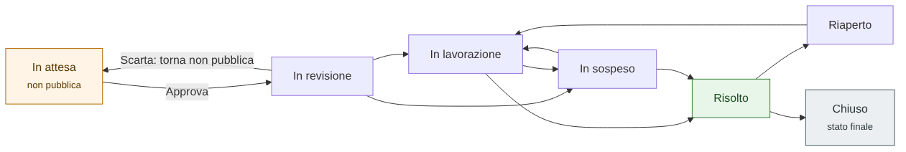

# Manuale d'uso FixCity - Panoramica

## Introduzione

FixCity è il portale con cui i cittadini segnalano al Comune un problema sul territorio, ad esempio una buca, un lampione
spento o i rifiuti abbandonati, e ne seguono la soluzione. Il personale del Comune riceve le segnalazioni in un pannello di
gestione, le valuta, le assegna e aggiorna lo stato fino alla chiusura.

Il manuale descrive il funzionamento previsto dal codice del progetto al 10 novembre 2026. Le schermate possono cambiare
leggermente da un Comune all'altro.

**Chi sei? Apri la tua guida.**

| Se sei… | Cosa fai con FixCity | La tua guida |
| --- | --- | --- |
| Un cittadino, anche senza account | Guardi le segnalazioni, ne invii di nuove, le segui | [Cittadini](cittadini.md) |
| Un dipendente del Comune che gestisce le segnalazioni | Approvi, assegni, aggiorni lo stato, rispondi | [Operatori](operatori.md) |
| Un capo ufficio, o il responsabile di una segnalazione | Coordini gli operatori o lavori le segnalazioni assegnate a te | [Supervisori e responsabili](supervisori-e-responsabili.md) |
| Chi gestisce accessi e contenuti per il Comune | Dai i ruoli, aggiorni le pagine, parli con il fornitore | [Amministratori](amministratori.md) |

Serve un browser aggiornato (Chrome, Firefox, Safari o Edge), su computer o smartphone. Il sito è disponibile in italiano,
inglese, tedesco e spagnolo; la lingua si sceglie dal menu in alto. Per inviare una segnalazione serve un account con email
e password, e l'email deve essere confermata.

## Stati di una segnalazione

Ogni segnalazione nasce **In attesa** e diventa pubblica solo quando un operatore la approva. Da lì avanza fino a
**Risolto** e **Chiuso**; il pannello consente solo i passaggi indicati dalle frecce.

*Figura 1 - Gli stati di una segnalazione e i passaggi consentiti.*

| Stato | Significato | Visibile al pubblico |
| --- | --- | --- |
| In attesa | Appena inviata, da valutare. Ci torna anche una segnalazione scartata, con il motivo | No |
| In revisione | Approvata, il Comune la sta esaminando | Sì |
| In lavorazione | L'intervento è in corso | Sì |
| In sospeso | Bloccata in attesa di altri uffici, fornitori o permessi | Sì |
| Risolto | L'intervento è concluso; il cittadino può valutarlo | Sì |
| Riaperto | Il problema si è ripresentato dopo la soluzione | Sì |
| Chiuso | Pratica archiviata, non più modificabile | Sì |

## Domande frequenti

**Ho inviato una segnalazione ma non la vedo sulla mappa.** Le nuove segnalazioni sono In attesa e diventano pubbliche solo
dopo l'approvazione di un operatore. Le tue le vedi sempre in **Area personale > Le mie segnalazioni**.

**Non riesco ad aprire il modulo di segnalazione: mi chiede di confermare l'email.** Dopo la registrazione ricevi un'email
con un collegamento: aprilo e torni al modulo. Se non la trovi, guarda nella cartella spam oppure premi il pulsante per
riceverla di nuovo.

**Ho perso il codice della segnalazione.** Accedi e apri **Area personale > Le mie segnalazioni**: trovi tutte le
segnalazioni che hai inviato, con il codice.

**Non ricevo email.** Controlla in **Area personale > Impostazioni e privacy** che le email siano attive e guarda nella
cartella spam. Lo stato aggiornato è comunque sempre nel dettaglio della segnalazione.

**Posso modificare o ritirare una segnalazione inviata?** Scrivi un commento nel dettaglio della segnalazione con la
correzione. Un operatore può scartarla se non è più necessaria.

**Posso accedere con SPID o CIE?** Non ancora: oggi l'accesso avviene con email e password, o con Google se il Comune l'ha
attivato.

## Problemi noti al 10 novembre 2026

| Problema | Chi è coinvolto | Cosa fare |
| --- | --- | --- |
| Il pannello di gestione risponde con un errore su fixcity.eu | Operatori e amministratori | La correzione è pronta; serve un nuovo rilascio sul server |
| Il riquadro di dettaglio della mappa non si apre con la tastiera | Chi naviga senza mouse | Usa la vista **Elenco** della pagina Segnalazioni, che mostra le stesse informazioni |
| Alcune pagine informative in tedesco e spagnolo compaiono in italiano | Utenti in de ed es | Nessuna azione; notifiche e modulo di segnalazione sono già tradotti |
| La descrizione accetta al massimo 200 caratteri | Cittadini | Aggiungi i dettagli in un commento dopo l'invio |
| L'invio è bloccato con il messaggio "dati dell'ente non configurati" | Cittadini | Il Comune deve ancora completare l'informativa privacy: avvisa l'ufficio indicato in **Contatti** |

## Assistenza

Per problemi con l'account o con una segnalazione rivolgiti all'ufficio del tuo Comune indicato nella pagina **Contatti**
del sito. Per problemi tecnici della piattaforma l'amministratore contatta il fornitore di FixCity.
